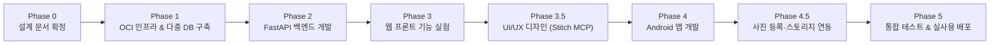

# 02. 개발 로드맵 (Development Roadmap)

> **상태**: 초안 (Draft)  
> **최종 수정일**: 2026-11-21  
> **관련 문서**: [프로젝트 개요](./01-project-overview.md), [OCI Always Free 인프라 설계](../02-architecture/02-oci-always-free-infra.md), [UI/UX 디자인 지침](../04-guides/05-ui-design-guidelines.md)

---

## 1. 전체 마일스톤 개요

---

## 2. 단계별 세부 계획

### Phase 0: 기획 및 설계 문서 확정 (현재 단계)
- [x] `docs/` 디렉토리 구조 및 문서 관리 규칙 수립
- [ ] 기획·아키텍처·기능 명세 문서 검토 및 `확정 (Final)` 전환
- [ ] 기존 저장소 코드(`backend/`, `front/`) 아카이빙 또는 신규 디렉토리 배치 결정

### Phase 1: OCI Always Free 인프라 및 다중 DB 기반 구축
- [ ] OCI Always Free 계정 내 VCN(네트워크), Compute VM 프로비저닝 및 무과금 예산 알림(Budget Alert) 설정
- [ ] 관리형 DB 선택 및 연결 구성: **OCI Autonomous DB (Always Free)** 또는 **Supabase (Free Tier PostgreSQL)**
- [ ] SQLAlchemy 2.0 + Alembic 기반 **DB 벤더 중립적(ANSI SQL) 스키마 및 Repository 어댑터** 구현 (`oracle` / `postgresql` 전환 테스트 포함)
- [ ] Compute VM 내 FastAPI 헬스체크 엔드포인트 + HTTPS(Reverse Proxy) 동작 검증

### Phase 2: FastAPI 백엔드 핵심 API 개발
- [ ] **인증 모듈**: Google/Kakao ID Token·Access Token 검증 및 자체 JWT(Access/Refresh) 발급·갱신
- [ ] **가구(Household) 모듈**: 가구 생성, 1회용/만료형 초대 코드 발급·참여, 구성원 목록/권한 관리
- [ ] **보관 장소 트리 모듈**: 자기참조 트리 CRUD, 순환 참조 방지 검증, 표준 `WITH RECURSIVE` CTE 기반 하위 노드 일괄 조회
- [ ] **품목 및 이력 모듈**: 식재료/완제품 CRUD, 수량 증감, 소비/폐기 처리, 변경 이력 자동 기록, 임박 품목 조회 API
- [ ] 백엔드 단위/통합 테스트 작성 (`pytest`) 및 Swagger(OpenAPI) 문서화

### Phase 3: 웹 프론트엔드 기능 실험 (Web Prototype / API·UX 검증)
Android 네이티브 앱 개발 전에 핵심 도메인 로직과 사용자 흐름을 웹 화면으로 빠르게 실험·검증합니다.
- [ ] 경량 웹 클라이언트 구성 (CORS 연동, 로그인/테스트 토큰 발급 및 JWT 세션 관리)
- [ ] **핵심 기능 실험 UI**: 가구 생성/초대 참여, 자유 트리 보관 장소 탐색·추가·이동, 품목 등록·수량 조절·소비/폐기, D-Day 임박 목록 및 변경 이력 확인
- [ ] 실험 결과를 바탕으로 API 스펙(요청/응답 필드, 에러 코드, UX 불편 사항) 보완 및 확정

### Phase 3.5: UI/UX 디자인 확정 (Google Stitch MCP)
본격적인 네이티브 앱 UI 구현 전, Google Stitch MCP로 디자인 시스템과 핵심 화면 시안을 먼저 생성·확정합니다. ([UI/UX 디자인 지침](../04-guides/05-ui-design-guidelines.md))
- [x] Stitch MCP 프로젝트 생성 및 공통 디자인 시스템(`Fresh Kitchen Material`) 수립
- [x] 핵심 4개 화면 시안 생성 (재고·장소 메인, 인증·가구 온보딩, 품목 등록 바텀시트, 가족·알림)
- [x] 시안 검토 및 세부 문구·레이아웃 보완 후 최종 디자인 확정

### Phase 4: Kotlin Android 앱 개발 (본격 모바일 클라이언트)
확정된 FastAPI 스펙과 **Stitch 확정 디자인 시안**을 기반으로 실사용 모바일 앱을 개발합니다.
- [x] 프로젝트 스캐폴딩 (Kotlin, Jetpack Compose, Hilt, Retrofit/OkHttp, Room, WorkManager)
- [x] **인증 & 가구 온보딩 UI**: Google/Kakao 소셜 로그인(체험 로그인 포함), 가구 생성 또는 초대 코드 입력 화면 (`Fresh Kitchen Material` 반영)
- [x] **보관 장소 탐색기 UI**: 트리 구조(폴더/하위 구역) 탐색, 하위 구역 포함 필터 토글, 보관 장소 추가/삭제
- [x] **품목 관리 UI**: 요약 대시보드, 품목 등록 바텀시트, D-Day 배지 표시, 빠른 수량 조절(+/-), 소비/폐기 액션, 검색/정렬
- [x] **로컬 캐시 & 알림**: Room 캐시 동기화 및 `WorkManager` 기반 유통기한 임박 로컬 알림 스케줄러 구현
- [x] **가족 & 변경 이력 UI**: 초대 코드 발급·복사, 최근 변경 이력 타임라인, 로컬 알림 기준일(D-1/3/5/7)·시간 설정

### Phase 4.5: 품목 사진 등록·상세조회 및 경량 스토리지 연동
서버 스토리지 및 1GB RAM VM 제약을 고려해 **2단계 WebP 압축(상세 1280px / 썸네일 400px)**과 **외부 스토리지(OCI Object Storage) + 상태 기반 TTL 정리**를 적용한 사진 등록 기능을 구현합니다.
- [x] **Stitch MCP 시안 개편**: `새 품목 등록 (바텀시트)` 상단 `사진으로 등록` 섹션(카메라/앨범, 식재료·영수증·바코드 모드, 프리뷰 카드) 반영
- [x] **설계 문서 확정**: 인프라(`02-oci-always-free-infra.md`), ERD(`03-database-erd.md`), API(`04-api-spec.md`), 기능 명세(`02-storage-and-inventory.md`) 업데이트
- [ ] **백엔드(`server/`) 구현**: `items` 테이블 `detail_image_key`/`thumb_image_key` Alembic 마이그레이션, `/items/photo-upload-url` Pre-signed URL(또는 `/data/media` 대안) 발급 API, 크기 상한(`500KB`/`100KB`) 검증 및 소비·폐기 후 30일 `detail` 정리 배치 + `pytest` 검증
- [ ] **Android(`android/`) 구현**: 카메라/앨범 선택 및 클라이언트 2단계 WebP 압축(`1280px`/`400px`), `새 품목 등록` 바텀시트 사진 등록·프리뷰 UI, 목록 썸네일 및 품목 상세페이지 고해상도 이미지 조회 구현 + 단위/빌드 테스트

### Phase 5: 통합 테스트, 안정화 및 실사용 배포
- [ ] Android ↔ OCI FastAPI ↔ 선택 DB(Oracle ADB / Supabase) 종단간(E2E) 연동 검증
- [ ] 네트워크 오프라인/지연 상황에서의 Room 캐시 폴백 및 에러 처리 검증
- [ ] 무료 티어 리소스 사용량(CPU/RAM/DB 스토리지/트래픽) 및 7일 미사용 자동 중지/일시정지 대응 점검
- [ ] 가족 구성원 기기 설치(APK 배포 또는 Google Play 내부 테스트 트랙) 및 추후 확장 기능(바코드/AI/레시피 등) 검토

---

## 3. 단계 완료 기준 (Definition of Done)

- 각 Phase의 모든 체크리스트 항목이 완료되고, 관련 `docs/` 문서가 실제 구현 내용과 일치하도록 업데이트되어야 합니다.
- 백엔드 변경 시 핵심 비즈니스 로직(인증, 트리 무결성, 가구 권한, 이력 기록)의 자동화 테스트가 통과해야 합니다.
- OCI 과금 발생 가능성이 있는 리소스가 추가되지 않았음을 배포 전 점검합니다.

---

## 변경 이력
- **2026-11-21**: Phase 3.5 (Google Stitch MCP 기반 UI/UX 디자인 확정) 단계 및 마일스톤 플로우차트 추가, Phase 4에 Stitch 확정 디자인 기준 반영 명시.
- **2026-11-21**: Stitch 확정 시안(`Fresh Kitchen Material`) 기반 Android Jetpack Compose UI 구현 완료 (`Theme.kt`, `AuthOnboardingScreen.kt`, `InventoryScreen.kt`, `FamilyAndSettingsScreen.kt`, `MainActivity.kt`) 및 `testDebugUnitTest` 통과.
- **2026-11-21**: 백엔드 `pytest` 9건 전체 통과 확인; Android 품목 보관 장소 이동(`moveItem`) 및 상단 가구 스위처(`switchHousehold`) 추가 후 `testDebugUnitTest` 통과.
- **2026-11-21**: `SM_S911N` 실기기 디버그 APK 설치(`app-debug.apk`), `adb reverse tcp:8080 tcp:8080` 포트 포워딩, FastAPI(`127.0.0.1:8080`) 라이브 E2E API 스모크 테스트(`LIVE_E2E_OK`) 및 `ruff check` 통과 확인.
- **2026-11-21**: **Phase 4.5 (품목 사진 등록·상세조회 및 경량 스토리지 연동)** 신설 — Stitch MCP 시안·설계 문서 완료 체크 및 백엔드(`server/`)·Android(`android/`) 구현 항목 등록.
