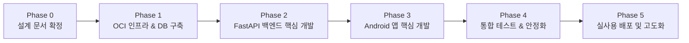

# 02. 개발 로드맵 (Development Roadmap)

> **상태**: 초안 (Draft)  
> **최종 수정일**: 2026-11-19  
> **관련 문서**: [프로젝트 개요](./01-project-overview.md), [OCI Always Free 인프라 설계](../02-architecture/02-oci-always-free-infra.md)

---

## 1. 전체 마일스톤 개요

---

## 2. 단계별 세부 계획

### Phase 0: 기획 및 설계 문서 확정 (현재 단계)
- [x] `docs/` 디렉토리 구조 및 문서 관리 규칙 수립
- [ ] 기획·아키텍처·기능 명세 문서 검토 및 `확정 (Final)` 전환
- [ ] 기존 저장소 코드(`backend/`, `front/`) 아카이빙 또는 신규 디렉토리(`server/`, `android/` 등) 배치 결정

### Phase 1: OCI Always Free 인프라 및 다중 DB 기반 구축
- [ ] OCI Always Free 계정 내 VCN(네트워크), Compute VM 프로비저닝 및 무과금 예산 알림(Budget Alert) 설정
- [ ] 관리형 DB 선택 및 연결 구성: **OCI Autonomous DB (Always Free)** 또는 **Supabase (Free Tier PostgreSQL)**
- [ ] SQLAlchemy 2.0 + Alembic 기반 **DB 벤더 중립적(ANSI SQL) 스키마 및 Repository 어댑터** 구현 (`oracle` / `postgresql` 전환 테스트 포함)
- [ ] Compute VM 내 FastAPI 헬스체크 엔드포인트 + HTTPS(Reverse Proxy) 동작 검증

### Phase 2: FastAPI 백엔드 핵심 API 개발
- [ ] **인증 모듈**: Google/Kakao ID Token·Access Token 검증 및 자체 JWT(Access/Refresh) 발급·갱신
- [ ] **가구(Household) 모듈**: 가구 생성, 1회용/만료형 초대 코드 발급·참여, 구성원 목록/권한 관리
- [ ] **보관 장소 트리 모듈**: 자기참조 트리 CRUD, 순환 참조 방지 검증, 표준 `WITH RECURSIVE` CTE 기반 하위 노드 일괄 조회
- [ ] **품목 및 이력 모듈**: 식재료/완제품 CRUD, 수량 증감, 소비/폐기 처리, 변경 이력 자동 기록, 임박 품목 조회 API
- [ ] 백엔드 단위/통합 테스트 작성 및 Swagger(OpenAPI) 문서화

### Phase 3: Kotlin Android 앱 핵심 개발
- [ ] 프로젝트 스캐폴딩 (Kotlin, Jetpack Compose, Hilt, Retrofit/OkHttp, Room, WorkManager)
- [ ] **인증 & 가구 온보딩 UI**: Google/Kakao 소셜 로그인, 가구 생성 또는 초대 코드 입력 화면
- [ ] **보관 장소 탐색기 UI**: 트리 구조(폴더/하위 구역) 탐색, 보관 장소 추가/편집/이동
- [ ] **품목 관리 UI**: 품목 등록/수정, D-Day 배지 표시, 빠른 수량 조절(+/-), 소비/폐기 액션, 검색/필터
- [ ] **로컬 캐시 & 알림**: Room 캐시 동기화 및 `WorkManager` 기반 유통기한 임박 로컬 알림 스케줄러 구현
- [ ] **가족 & 변경 이력 UI**: 구성원 목록, 초대 코드 복사/공유, 최근 변경 이력 타임라인

### Phase 4: 통합 테스트 및 안정화
- [ ] Android ↔ OCI FastAPI ↔ 선택 DB(Oracle ADB / Supabase) 종단간(E2E) 연동 검증
- [ ] 네트워크 오프라인/지연 상황에서의 Room 캐시 폴백 및 에러 처리 검증
- [ ] 무료 티어 리소스 사용량(CPU/RAM/DB 스토리지/트래픽) 및 7일 미사용 자동 중지/일시정지 대응 점검

### Phase 5: 실사용 배포 및 추후 확장
- [ ] 가족 구성원 기기 설치(APK 배포 또는 Google Play 내부 테스트 트랙) 및 실사용 피드백 수집
- [ ] (선택) 바코드 스캔, AI 사진/영수증 인식, 장보기 리스트 등 확장 기능 설계 착수

---

## 3. 단계 완료 기준 (Definition of Done)

- 각 Phase의 모든 체크리스트 항목이 완료되고, 관련 `docs/` 문서가 실제 구현 내용과 일치하도록 업데이트되어야 합니다.
- 백엔드 변경 시 핵심 비즈니스 로직(인증, 트리 무결성, 가구 권한, 이력 기록)의 자동화 테스트가 통과해야 합니다.
- OCI 과금 발생 가능성이 있는 리소스가 추가되지 않았음을 배포 전 점검합니다.
