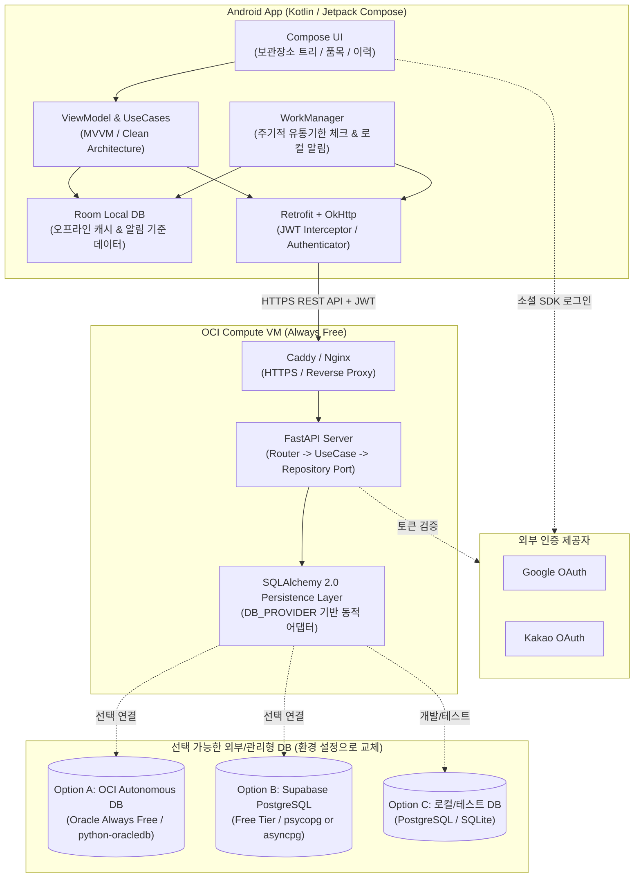

# 01. 전체 시스템 아키텍처 (System Architecture)

> **상태**: 초안 (Draft)  
> **최종 수정일**: 2026-11-19  
> **관련 문서**: [OCI Always Free 및 무료 DB 인프라 설계](./02-oci-always-free-infra.md), [DB ERD 및 호환성 설계](./03-database-erd.md), [API 명세](./04-api-spec.md)

---

## 1. 시스템 구성도 (다중 DB 플러그인 구조)

---

## 2. 계층별 책임 분리 및 DB 추상화 원칙

### 2.1 Android 클라이언트 (Kotlin)
- **Presentation Layer**: Jetpack Compose 기반 단방향 데이터 흐름(UDF), UI State 관리
- **Domain Layer**: 비즈니스 모델 및 유스케이스(트리 경로 계산, D-Day 계산, 재고 검증)
- **Data Layer**:
  - `RemoteDataSource`: Retrofit 기반 FastAPI 통신, OkHttp `Interceptor`로 Access Token 주입 및 `Authenticator`로 Refresh Token 자동 갱신
  - `LocalDataSource`: Room DB를 활용한 보관 장소/품목 캐싱(빠른 초기 로딩 및 오프라인 조회 지원)
- **Background Layer**: `WorkManager`가 하루 1~2회 백그라운드에서 서버 최신 품목 동기화(가능 시) 후 Room 데이터 기준으로 임박/만료 품목을 판별하여 Android 로컬 알림 발송

### 2.2 백엔드 API 서버 (FastAPI) — DB 벤더 중립 설계
특정 DB(Oracle 또는 Supabase)에 비즈니스 로직이 종속되지 않도록 **Port & Adapter(Hexagonal / Clean Architecture)** 구조를 적용합니다.

- **API / Router Layer**: 요청 검증(Pydantic v2), JWT 인증 및 가구 소속 권한(Authorization) 검증
- **Application / UseCase Layer**: 순수 도메인/비즈니스 로직 수행 (특정 DB SQL 문법이나 드라이버 코드 금지)
- **Repository Port (Interface)**: `UserRepository`, `HouseholdRepository`, `LocationRepository`, `ItemRepository`, `ActivityLogRepository` 추상 인터페이스 정의
- **Persistence Adapter (SQLAlchemy 2.0)**:
  - **SQLAlchemy Core/ORM 표준 타입**과 **ANSI SQL 표준 문법**(`WITH RECURSIVE` CTE 등)을 사용하여 단일 코드베이스로 Oracle과 PostgreSQL(Supabase)을 모두 지원합니다.
  - DB 연결 엔진 팩토리(`create_db_engine`)가 환경 변수(`DB_PROVIDER`, `DATABASE_URL`)에 따라 Oracle(`oracle+oracledb`) 또는 Supabase/PostgreSQL(`postgresql+psycopg` / `postgresql+asyncpg`) 설정(Pooler, Wallet/TLS, 헬스체크 쿼리 등)을 분기 처리합니다.
  - Supabase를 사용하더라도 Supabase 전용 SDK(PostgREST/Auth)에 결합하지 않고 **표준 PostgreSQL 연결(SQLAlchemy)**을 사용하여 Oracle ↔ Supabase 간 100% 교체 가능성을 유지합니다.

---

## 3. 핵심 데이터 흐름

### 3.1 소셜 로그인 및 JWT 발급
1. Android 앱에서 Google 또는 Kakao SDK를 통해 소셜 토큰(ID Token / Access Token) 획득
2. 앱이 FastAPI `POST /api/v1/auth/social/{provider}`로 토큰 전송
3. FastAPI가 Google/Kakao 검증 엔드포인트(또는 JWKS)로 토큰 유효성 확인 후 사용자 조회/생성
4. FastAPI가 자체 JWT `access_token`(단기) 및 `refresh_token`(장기, DB 해시 저장) 발급

### 3.2 재고 변경 및 가족 공유
1. 가족 구성원 A가 품목 등록·수정·소비·폐기 API 호출
2. FastAPI가 단일 DB 트랜잭션 내에서 `items` 테이블 갱신 + `activity_logs` 변경 이력 저장
3. 가족 구성원 B가 앱 실행 또는 새로고침 시 최신 재고와 변경 이력을 조회하고 Room 캐시 갱신

### 3.3 유통기한 로컬 알림
1. Android `WorkManager`의 `PeriodicWorkRequest`가 지정 시간(예: 매일 오전 9시)에 실행
2. 네트워크 연결 시 `GET /api/v1/households/{id}/items/expiring` 호출하여 Room 갱신 (오프라인 시 기존 Room 캐시 사용)
3. 사용자 알림 설정(예: D-3, D-1, 당일)에 해당하는 품목이 있으면 Android `NotificationManager`로 요약 알림 표시
