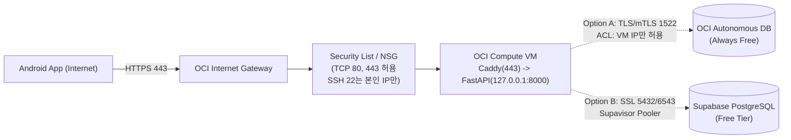

# 02. OCI Always Free 및 무료 DB 인프라 설계

> **상태**: 초안 (Draft)  
> **최종 수정일**: 2026-11-19  
> **관련 문서**: [전체 시스템 아키텍처](./01-system-architecture.md), [백엔드 개발·배포 가이드](../04-guides/01-backend-setup.md)

---

## 1. 핵심 원칙: 100% 무과금(Zero-Cost) 및 DB 선택 유연성

본 프로젝트의 API 서버는 **OCI Always Free Compute VM**에서 운영하며, 데이터베이스는 운영 상황과 선호도에 따라 아래 **무료 관리형 DB 서비스 중 하나를 선택하거나 교체**하여 연결할 수 있습니다.

- **Option A**: **OCI Autonomous Database (Always Free)** — 같은 OCI 클라우드 내 저지연 연동, 20GB 대용량 무료 스토리지
- **Option B**: **Supabase (Free Tier PostgreSQL)** — 표준 PostgreSQL 15+, 대시보드/테이블 뷰어 편리, 간편한 연결 문자열

> [!IMPORTANT]
> 어떤 DB를 선택하든 **유료 옵션(Auto Scaling, Pro 플랜 자동 업그레이드, 유료 Load Balancer, NAT Gateway 등)은 절대 활성화하지 않으며**, OCI 콘솔에 **월 \$1 Budget Alert**를 필수 등록합니다.

---

## 2. 공통 컴퓨팅 인프라 (OCI Always Free)

| 리소스 | 사양 (Always Free 한도) | 용도 | 주의사항 |
|---|---|---|---|
| **Compute VM** | `VM.Standard.A1.Flex` (ARM Ampere, 1~2 OCPU / 6~12GB RAM) 또는 `VM.Standard.E2.1.Micro` (AMD 1/8 OCPU, 1GB RAM) | FastAPI 서버 + Caddy(HTTPS) 실행 | Boot Volume 50GB 이하 유지 (총 Block Volume 무료 한도 200GB) |
| **VCN / Subnet** | VCN 1개, Public Subnet 1개, Internet Gateway 1개 | 외부 HTTPS(443) 인바운드 및 외부 DB/OAuth 아웃바운드 | NAT Gateway는 유료이므로 사용 금지 |
| **Reverse Proxy** | VM 내부 Caddy (Let's Encrypt 자동 TLS) | 무료 HTTPS 종단 | 유료 OCI Load Balancer 대체 |
| **Outbound Data** | 월 10TB 무료 | API JSON 트래픽 및 외부 DB 통신 | 1차 버전에서는 이미지 업로드 배제로 트래픽 최소화 |

---

## 3. 무료 관리형 DB 옵션 비교 및 제약 사항

| 비교 항목 | Option A: OCI Autonomous DB (ATP Always Free) | Option B: Supabase (Free Tier PostgreSQL) |
|---|---|---|
| **DB 엔진** | Oracle Database (19c / 23ai) | PostgreSQL |
| **무료 스토리지** | **20GB** (매우 넉넉함) | **500MB** (텍스트 재고/이력 기준 가족용으로 충분) |
| **네트워크 지연** | OCI 동일 리전 내 초저지연 | OCI VM → Supabase 리전(예: Seoul `ap-northeast-2`) 경유 |
| **접속 방식** | One-Way TLS(ACL에 VM IP 허용) 또는 mTLS(Wallet) | Supavisor Connection Pooler (IPv4 호환 포트 `6543`/`5432`, SSL 필수) |
| **비활성 자동 중지** | **7일 연속 미사용 시 자동 중지** (90일 미사용 시 삭제) | **7일 연속 비활성 시 프로젝트 일시정지(Pause)** |
| **과금 방지 핵심** | 생성 시 **Auto Scaling OFF** 필수 | Free 플랜은 한도 도달 시 차단(과금 없음), 결제 카드 미등록 유지 |

---

## 4. 네트워크 및 보안 아키텍처

---

## 5. 무료 티어 운영 시 필수 대응 전략

1. **7일 미사용 자동 중지/일시정지(Auto-Pause) 공통 대응**:
   - OCI Autonomous DB와 Supabase Free Tier 모두 **7일간 DB 활동이 없으면 자동으로 중지/일시정지**됩니다.
   - **대응**: OCI Compute VM의 `cron`에서 매일 1회 FastAPI `/api/v1/health`를 호출하여 DB 연결 헬스체크 쿼리를 실행함으로써 자동 중지를 방지합니다.
2. **Supabase IPv4/IPv6 및 Connection Pooler 주의**:
   - OCI Compute VM 기본 환경이 IPv4 전용인 경우, Supabase Direct Connection(IPv6 전용인 경우 있음) 대신 **Supavisor Session/Transaction Pooler(IPv4 지원)** URL을 사용해야 합니다.
   - Transaction Pooler(`6543`) 사용 시 SQLAlchemy/psycopg의 Prepared Statement 충돌을 방지하기 위해 `prepare_threshold=None` (또는 Session Pooler `5432`) 설정을 적용합니다.
3. **스토리지 한도 관리 (특히 Supabase 500MB 기준)**:
   - 품목 이미지 바이너리는 DB에 저장하지 않으며, `activity_logs` 변경 이력은 90~180일 보관 후 오래된 로그를 정리하는 배치/정책을 둡니다.
4. **Compute VM 유휴 회수 및 빠른 복구**:
   - 서버 실행 환경은 Docker Compose로 코드화하여 VM 재생성 시 10분 내 복구 가능하게 유지합니다.
