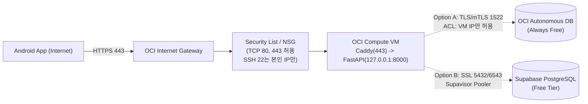

# 02. OCI Always Free 및 무료 DB 인프라 설계

> **상태**: 초안 (Draft)  
> **최종 수정일**: 2026-11-21  
> **관련 문서**: [전체 시스템 아키텍처](./01-system-architecture.md), [백엔드 개발·배포 가이드](../04-guides/01-backend-setup.md)

---

## 1. 핵심 원칙: 100% 무과금(Zero-Cost) 및 DB 선택 유연성

본 프로젝트의 API 서버는 **OCI Always Free Compute VM**에서 운영하며, 데이터베이스는 운영 상황과 선호도에 따라 아래 **무료 관리형 DB 서비스 중 하나를 선택하거나 교체**하여 연결할 수 있습니다.

- **Option A**: **OCI Autonomous Database (Always Free)** — 같은 OCI 클라우드 내 저지연 연동, 20GB 대용량 무료 스토리지
- **Option B**: **Supabase (Free Tier PostgreSQL)** — 표준 PostgreSQL 15+, 대시보드/테이블 뷰어 편리, 간편한 연결 문자열

> [!IMPORTANT]
> 어떤 DB를 선택하든 **유료 옵션(Auto Scaling, Pro 플랜 자동 업그레이드, 유료 Load Balancer, NAT Gateway 등)은 절대 활성화하지 않으며**, OCI 콘솔에 **월 \$1 Budget Alert**를 필수 등록합니다.

---

## 2. 공통 컴퓨팅 인프라 (OCI Always Free)

| 리소스 | 사양 (Always Free 한도) | 용도 | 주의사항 |
|---|---|---|---|
| **Compute VM** | `VM.Standard.E2.1.Micro` (AMD 1/8 OCPU, 1GB RAM + 2GB Swap) 또는 `VM.Standard.A1.Flex` (ARM Ampere, 1~2 OCPU / 6~12GB RAM) | FastAPI 서버 + Caddy(HTTPS) 실행 (OS: Oracle Linux 9, `opc` 계정) | Boot Volume 50GB 이하 유지 (현재 46.6GB, 총 Block Volume 무료 한도 200GB). `ap-tokyo-1` 리전 `A1.Flex` 재고 부족 시 `E2.1.Micro` 우선 사용 |
| **VCN / Subnet** | VCN `RefriManager` (`10.0.0.0/16`), Public Subnet (`10.0.0.0/24`), Internet Gateway 1개 | 외부 HTTP/HTTPS(80, 443) 및 SSH(22) 인바운드, 외부 DB/OAuth 아웃바운드 | NAT Gateway는 유료이므로 사용 금지. OS `firewalld`에서도 `http`/`https` 개방 필수 |
| **Reverse Proxy** | VM 내부 Caddy (Let's Encrypt 자동 TLS) | 무료 HTTPS 종단 | 유료 OCI Load Balancer 대체 |
| **Object Storage** | **OCI Object Storage (Always Free 20GB)** | 품목 상세(`1280px`)·썸네일(`400px`) WebP 이미지 저장 | Pre-signed URL(PAR) 직전송으로 1GB RAM VM 부하 우회. 미연동 시 VM 볼륨(`/data/media`) + Caddy 정적 서빙 대안 사용 |
| **Outbound Data** | 월 10TB 무료 | API JSON 트래픽, 외부 DB 통신 및 이미지 서빙 | 클라이언트 WebP 2단계 압축으로 트래픽 최소화 |

---

## 3. 무료 관리형 DB 옵션 비교 및 제약 사항

| 비교 항목 | Option A: OCI Autonomous DB (ATP Always Free) | Option B: Supabase (Free Tier PostgreSQL) |
|---|---|---|
| **DB 엔진** | Oracle Database (19c / 23ai) | PostgreSQL |
| **무료 스토리지** | **20GB** (매우 넉넉함) | **500MB** (텍스트 재고/이력 기준 가족용으로 충분) |
| **네트워크 지연** | OCI 동일 리전 내 초저지연 | OCI VM → Supabase 리전(예: Seoul `ap-northeast-2`) 경유 |
| **접속 방식** | One-Way TLS(ACL에 VM IP 허용) 또는 mTLS(Wallet) | Supavisor Connection Pooler (IPv4 호환 포트 `6543`/`5432`, SSL 필수) |
| **비활성 자동 중지** | **7일 연속 미사용 시 자동 중지** (90일 미사용 시 삭제) | **7일 연속 비활성 시 프로젝트 일시정지(Pause)** |
| **과금 방지 핵심** | 생성 시 **Auto Scaling OFF** 필수 | Free 플랜은 한도 도달 시 차단(과금 없음), 결제 카드 미등록 유지 |

---

## 4. 네트워크 및 보안 아키텍처

---

## 5. 무료 티어 운영 시 필수 대응 전략

1. **7일 미사용 자동 중지/일시정지(Auto-Pause) 공통 대응**:
   - OCI Autonomous DB와 Supabase Free Tier 모두 **7일간 DB 활동이 없으면 자동으로 중지/일시정지**됩니다.
   - **대응**: OCI Compute VM의 `cron`에서 매일 1회 FastAPI `/api/v1/health`를 호출하여 DB 연결 헬스체크 쿼리를 실행함으로써 자동 중지를 방지합니다.
2. **Supabase IPv4/IPv6 및 Connection Pooler 주의**:
   - OCI Compute VM 기본 환경이 IPv4 전용인 경우, Supabase Direct Connection(IPv6 전용인 경우 있음) 대신 **Supavisor Session/Transaction Pooler(IPv4 지원)** URL을 사용해야 합니다.
   - Transaction Pooler(`6543`) 사용 시 SQLAlchemy/psycopg의 Prepared Statement 충돌을 방지하기 위해 `prepare_threshold=None` (또는 Session Pooler `5432`) 설정을 적용합니다.
3. **스토리지 한도 및 이미지 용량 관리 (1GB RAM VM · 무료 티어 보호)**:
   - 품목 이미지 바이너리는 DB에 절대 저장하지 않으며(`items` 테이블에는 `detail_image_key` / `thumb_image_key` 키만 저장), 실제 파일은 **OCI Object Storage (Always Free 20GB)** 또는 VM 내 상한 격리 디렉토리(`/data/media`)에 저장합니다.
   - **클라이언트 선(先)압축 필수**: 1GB RAM VM의 OOM 방지를 위해 리사이징·WebP 인코딩은 반드시 Android 앱에서 수행합니다.
     - 상세페이지용(`detail`): 긴 변 `1280px`, WebP(품질 80%), 서버 업로드 상한 **`500KB`**
     - 목록 카드용(`thumb`): 긴 변 `400px`, WebP(품질 72%), 서버 업로드 상한 **`100KB`**
   - **계층형 수명주기(Tiered TTL) 자동 정리**:
     - `ACTIVE`(보관 중): `detail` + `thumb` 모두 유지
     - `CONSUMED`(소비) / `DISCARDED`(폐기) 후 **30일 경과**: 고해상도 `detail` 이미지 자동 삭제(이력 확인용 `thumb`만 유지하거나 정책에 따라 일괄 삭제)
     - 품목 영구 삭제(`DELETE`): 연결된 이미지 즉시 삭제
   - `activity_logs` 변경 이력은 90~180일 보관 후 오래된 로그를 정리하는 배치/정책을 둡니다.
4. **Compute VM 유휴 회수 및 빠른 복구**:
   - 서버 실행 환경은 Docker Compose(`server/compose.prod.yml`)로 코드화하여 VM 재생성 시 10분 내 복구 가능하게 유지합니다.

---

## 6. 현재 구성된 배포·CI/CD 환경 (2026-11-21 기준)

- **리전 / 네트워크**: `ap-tokyo-1` (Japan East Tokyo), VCN `RefriManager` (Security List 인바운드 TCP `22`, `80`, `443` 허용)
- **컴퓨트 인스턴스**: `VM.Standard.E2.1.Micro` (Oracle Linux 9, Boot Volume 46.6GB, Swap 2GB 추가 권장)
- **단계별 DB 운용 전략**:
  - **1단계 (기능 테스트)**: `server/.env`에 `COMPOSE_PROFILES=local-db`를 지정해 VM 내부 Docker PostgreSQL(`postgres:16-alpine`)로 검증
  - **2단계 (실제 운영)**: `COMPOSE_PROFILES`를 비우고 `DB_PROVIDER=oracle`로 전환해 **OCI Autonomous DB (Always Free)** 연결
- **자동 배포 (CI/CD)**: `.github/workflows/deploy-server.yml`을 통해 `main` 브랜치 `server/**` 변경 시 `ruff`·`pytest` 검증 후 OCI VM에 SSH(`opc`) 접속하여 자동 재빌드·재시작 및 `/api/v1/health` 헬스체크 수행

---

## 변경 이력

| 날짜 | 변경 내용 | 주요 파일 |
|---|---|---|
| 2026-11-21 | 실제 생성된 OCI 리소스(`ap-tokyo-1`, VCN `RefriManager`, `VM.Standard.E2.1.Micro` / Oracle Linux 9) 및 2단계 DB 전환·CI/CD 구성 반영 | `docs/02-architecture/02-oci-always-free-infra.md` |
| 2026-11-21 | 품목 사진 등록·상세페이지 조회를 위한 2단계 WebP 규격(`detail 1280px` + `thumb 400px`), OCI Object Storage(20GB Always Free)/Pre-signed URL 및 소비·폐기 후 30일 TTL 정리 정책 반영 | `docs/02-architecture/02-oci-always-free-infra.md` |
