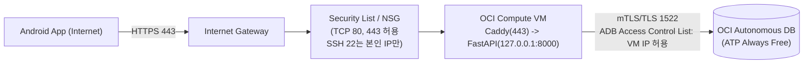

# 02. OCI Always Free 무과금 인프라 설계

> **상태**: 초안 (Draft)  
> **최종 수정일**: 2026-11-19  
> **관련 문서**: [전체 시스템 아키텍처](./01-system-architecture.md), [백엔드 개발·배포 가이드](../04-guides/01-backend-setup.md)

---

## 1. 핵심 원칙: 100% Always Free 무과금 보장

본 프로젝트의 모든 클라우드 리소스는 **OCI Always Free 티어 범위 내에서만 프로비저닝**하며, 유료 리소스(유료 Load Balancer, 유료 Object Storage 초과, 자동 확장(Auto Scaling) 등)는 절대 활성화하지 않습니다.

> [!IMPORTANT]
> OCI 계정 생성 시 기본 제공되는 Free Trial 크레딧이 종료되더라도 과금이 발생하지 않도록, **처음부터 Always Free 배지가 붙은 리소스만 생성**하고 **Pay-As-You-Go 전환 전 또는 전환 후에도 Always Free 한도 엄수 + Budget Alert(예산 1원/\$1 알림)**를 반드시 설정합니다.

---

## 2. 사용할 OCI Always Free 리소스 구성

| 리소스 | 사양 (Always Free 한도) | 용도 | 주의사항 |
|---|---|---|---|
| **Compute VM** | `VM.Standard.A1.Flex` (ARM Ampere, 최대 4 OCPU / 24GB RAM 중 1~2 OCPU / 6~12GB RAM 할당) 또는 `VM.Standard.E2.1.Micro` (AMD 1/8 OCPU, 1GB RAM) | FastAPI 서버 + Caddy(HTTPS) 실행 | Boot Volume은 기본 50GB 이하 유지 (Always Free 총 Block Volume 한도 200GB) |
| **Autonomous Database** | Autonomous Transaction Processing (ATP) Always Free (1 OCPU/2 ECPU, 20GB 스토리지) | 메인 관계형 데이터베이스 | **Auto Scaling 반드시 OFF** (ON 시 과금 가능성 차단) |
| **VCN / Subnet** | VCN 1개, Public Subnet 1개, Internet Gateway 1개 | 외부 HTTPS(443) 인바운드 및 아웃바운드 통신 | NAT Gateway는 유료이므로 사용 금지 (Public Subnet + 보안 목록/NSG 사용) |
| **Outbound Data** | 월 10TB 무료 | API JSON 응답 트래픽 | 이미지 업로드를 배제하여 트래픽 최소화 |

---

## 3. 네트워크 및 보안 아키텍처

### 보안 및 비용 방지 체크리스트
- **HTTPS 무료 인증서**: 도메인(무료 DuckDNS 또는 보유 도메인) + **Caddy**의 자동 Let's Encrypt TLS 적용 (유료 OCI Load Balancer 대신 VM 내 Reverse Proxy 사용).
- **DB 접근 제어(ACL)**: Autonomous Database의 접근 제어 목록(ACL)에 **Compute VM의 Public IP만 허용**하여 외부 무차별 접속 차단.
- **이미지 저장소 배제**: 1차 버전에서는 품목 이미지 파일을 서버/Object Storage에 저장하지 않고 텍스트·카테고리·아이콘 중심으로 운영하여 스토리지 및 트래픽 한도를 여유 있게 유지.

---

## 4. OCI Always Free 운영 시 필수 주의사항 및 대응 전략

1. **Autonomous DB 7일 미사용 자동 중지 (Auto-Stop)**:
   - OCI Always Free ADB는 **7일 연속 DB 연결 활동이 없으면 자동으로 중지(Stopped)**되며, 90일 미사용 시 삭제될 수 있습니다.
   - **대응**: Compute VM 내 FastAPI(또는 시스템 `cron`)에서 하루 1회 경량 헬스체크 쿼리(`SELECT 1 FROM DUAL`)를 실행하여 DB 활성 상태를 유지합니다.
2. **Compute VM 유휴 회수 정책**:
   - OCI는 장기간 CPU/네트워크 사용량이 극히 낮은 Always Free VM을 유휴(Idle)로 판단해 회수할 수 있습니다.
   - **대응**: 주기적인 헬스체크 및 실사용 트래픽으로 활성 상태를 유지하고, 서버 설정과 앱 배포는 Docker Compose 또는 스크립트로 코드화(IaC/자동화)하여 VM 재생성 시 10분 내 복구 가능하도록 구성합니다.
3. **ARM(`A1.Flex`) vs AMD(`E2.1.Micro`) 선택**:
   - 리전 내 `A1.Flex` 용량이 확보되면 `A1.Flex`(1~2 OCPU, 6GB RAM)를 최우선 권장합니다. Python/FastAPI 및 `python-oracledb`(Thin 모드, 순수 Python/ARM 호환) 모두 원활히 동작합니다.
   - `A1.Flex` 품절 시 `E2.1.Micro`(1GB RAM)를 사용하되, Uvicorn 워커 수를 1~2개로 제한하고 1~2GB Swap 파일을 설정하여 OOM을 방지합니다.
4. **예산 알림(Budget Alert)**:
   - OCI 콘솔 `Billing & Cost Management > Budgets`에서 월 예상 비용 **\$1 초과 시 이메일 알림**을 필수 등록합니다.
