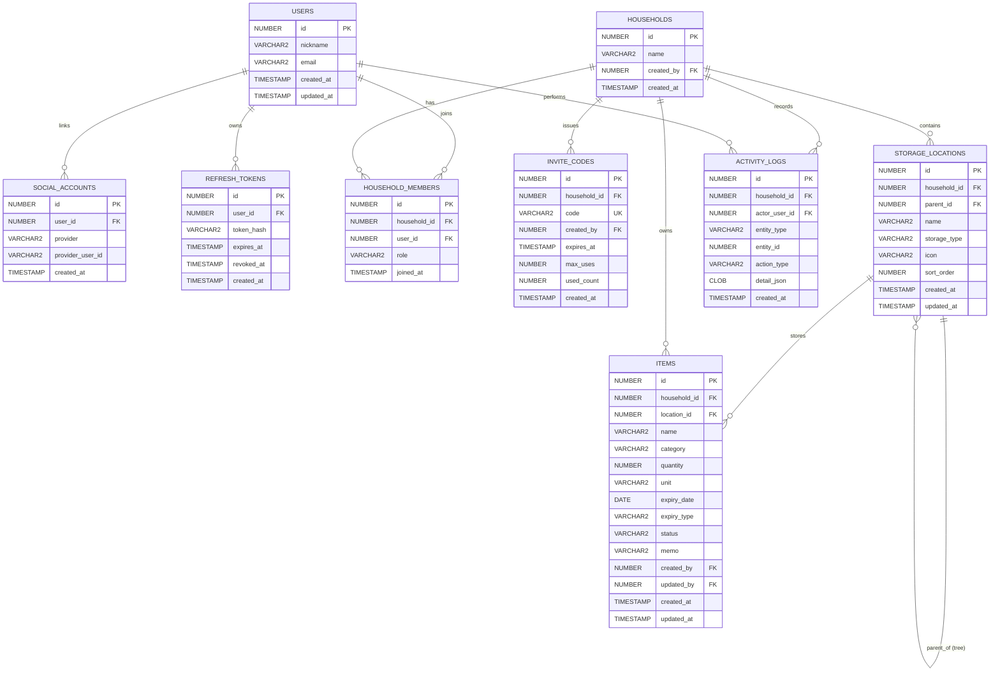

# 03. 데이터베이스 설계 (Oracle Autonomous DB ERD)

> **상태**: 초안 (Draft)  
> **최종 수정일**: 2026-11-19  
> **관련 문서**: [전체 시스템 아키텍처](./01-system-architecture.md), [보관 장소 및 재고 명세](../03-features/02-storage-and-inventory.md)

---

## 1. 논리 ERD



---

## 2. 주요 테이블 상세 설계 (Oracle DB 기준)

Oracle Autonomous Database (19c/23ai) 특성을 반영하여 PK는 `GENERATED BY DEFAULT AS IDENTITY`, 타임스탬프는 `TIMESTAMP WITH TIME ZONE`을 기본으로 사용합니다.

### 2.1 `USERS` / `SOCIAL_ACCOUNTS` / `REFRESH_TOKENS`
- `SOCIAL_ACCOUNTS`: `(provider, provider_user_id)` 복합 유니크 제약(`GOOGLE`, `KAKAO`)으로 동일 소셜 계정 중복 가입 방지.
- `REFRESH_TOKENS`: 평문 대신 SHA-256 해시(`token_hash`) 저장, 로그아웃 또는 토큰 회전(Rotation) 시 `revoked_at` 기록.

### 2.2 `HOUSEHOLDS` / `HOUSEHOLD_MEMBERS` / `INVITE_CODES`
- `HOUSEHOLD_MEMBERS`: `(household_id, user_id)` 유니크 제약, `role`은 `OWNER` | `MEMBER`.
- `INVITE_CODES`: 대문자 영숫자 6~8자리 코드(`code`), 기본 만료 시간 24시간, 최대 사용 횟수(`max_uses`) 지원.

### 2.3 `STORAGE_LOCATIONS` (자유 트리 구조)
- `parent_id`: 최상위 루트 보관 장소(예: `안방 냉장고`, `주방 팬트리`)는 `NULL`, 하위 구역(예: `냉동실`, `2단 선반`)은 상위 `STORAGE_LOCATIONS.id` 참조.
- **무결성 규칙**:
  - `parent_id`가 존재할 경우 반드시 동일한 `household_id`에 속해야 함(애플리케이션 레벨 검증).
  - 자기 자신이나 자신의 하위 노드를 `parent_id`로 지정하는 순환 참조(Cycle) 금지.
  - 하위 장소나 품목이 남아있는 장소 삭제 시 처리 정책은 API 파라미터(`cascade` 또는 `move_to_location_id`)로 명시적 처리.
- **Oracle 계층 조회 예시**:
  ```sql
  SELECT id, parent_id, name, LEVEL AS depth,
         SYS_CONNECT_BY_PATH(name, ' > ') AS full_path
  FROM storage_locations
  WHERE household_id = :household_id
  START WITH parent_id IS NULL
  CONNECT BY PRIOR id = parent_id
  ORDER SIBLINGS BY sort_order, id;
  ```

### 2.4 `ITEMS` (식재료 및 완제품)
- `category`: `FRESH`(신선식품), `MEAT_FISH`(육류/수산), `DAIRY`(유제품), `PROCESSED`(가공/완제품), `BEVERAGE`(음료), `SAUCE`(양념/소스), `ETC`(기타)
- `quantity`: `NUMBER(10, 2)` (소수점 수량 지원, 예: `0.5`, `1.5`)
- `expiry_type`: `USE_BY`(소비기한) | `BEST_BEFORE`(유통기한) | `NONE`(기한 없음)
- `status`: `ACTIVE`(보관 중) | `CONSUMED`(소비 완료) | `DISCARDED`(폐기)

### 2.5 `ACTIVITY_LOGS` (가족 변경 이력)
- `entity_type`: `ITEM` | `LOCATION` | `MEMBER`
- `action_type`: `CREATED` | `UPDATED` | `MOVED` | `CONSUMED` | `DISCARDED` | `DELETED` | `JOINED`
- `detail_json`: 변경 전/후 스냅샷 및 요약 정보 (`IS JSON` 체크 제약 적용).
- **스토리지 관리 (20GB 한도 대응)**: 이력이 무한히 쌓이지 않도록 90일 또는 180일 초과 로그는 주기적 정리(Purge) 정책 적용 고려.

---

## 3. 주요 인덱스 전략

| 테이블 | 인덱스 컬럼 | 목적 |
|---|---|---|
| `STORAGE_LOCATIONS` | `(household_id, parent_id, sort_order)` | 트리 탐색 및 정렬 최적화 |
| `ITEMS` | `(household_id, status, expiry_date)` | 임박/만료 품목 조회 및 WorkManager 동기화 최적화 |
| `ITEMS` | `(household_id, location_id, status)` | 특정 보관 장소 내 재고 목록 조회 |
| `ACTIVITY_LOGS` | `(household_id, created_at DESC)` | 가구별 최신 변경 이력 페이지네이션 |
