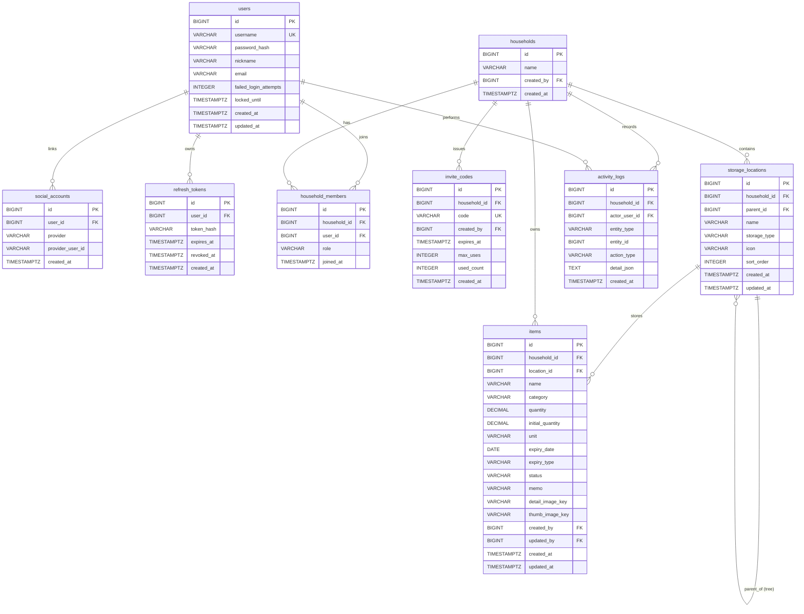

# 03. 데이터베이스 설계 (DB 벤더 중립 ERD 및 호환성 가이드)

> **상태**: 초안 (Draft)  
> **최종 수정일**: 2026-11-25  
> **관련 문서**: [전체 시스템 아키텍처](./01-system-architecture.md), [보관 장소 및 재고 명세](../03-features/02-storage-and-inventory.md)

---

## 1. DB 벤더 중립 설계 원칙

본 스키마는 **Oracle Autonomous Database**와 **Supabase (PostgreSQL)**를 비롯한 표준 RDBMS 어디서나 동일한 애플리케이션 코드로 동작하도록 설계합니다.

1. **ANSI SQL 표준 타입 사용**: 특정 벤더 전용 타입(`VARCHAR2`, `NUMBER`, `JSONB`, `UUID` 전용 함수 등)에 직접 의존하지 않고, SQLAlchemy 2.0 추상 타입을 통해 각 DB 방언(Dialect)으로 매핑합니다.
2. **표준 계층 쿼리 사용**: 자유 트리 보관 장소 조회 시 Oracle 전용 `CONNECT BY` 대신 Oracle과 PostgreSQL 모두 지원하는 **ANSI 표준 `WITH RECURSIVE` CTE** (또는 가구 단위 전체 노드 조회 후 애플리케이션 메모리 트리 조립)를 사용합니다.
3. **식별자 네이밍**: 모든 테이블명과 컬럼명은 소문자 `snake_case`를 사용하며, Oracle/PostgreSQL 양쪽의 예약어(`user`, `group`, `order`, `level`, `date` 등)를 피합니다.

---

## 2. 논리 ERD (ANSI SQL 표준 타입 기준)

---

## 3. SQLAlchemy ↔ Oracle / PostgreSQL(Supabase) 타입 매핑

| 논리 타입 | SQLAlchemy 2.0 정의 | Oracle ADB 매핑 | Supabase (PostgreSQL) 매핑 |
|---|---|---|---|
| **PK Identity** | `BigInteger` + `Identity()` | `NUMBER(19) GENERATED BY DEFAULT AS IDENTITY` | `BIGINT GENERATED BY DEFAULT AS IDENTITY` |
| **문자열** | `String(n)` | `VARCHAR2(n CHAR)` | `VARCHAR(n)` |
| **수량(소수점)** | `Numeric(10, 2)` | `NUMBER(10, 2)` | `NUMERIC(10, 2)` |
| **날짜** | `Date` | `DATE` | `DATE` |
| **타임스탬프(UTC)** | `DateTime(timezone=True)` | `TIMESTAMP WITH TIME ZONE` | `TIMESTAMPTZ` |
| **JSON 이력** | `JSON` (또는 `Text` + 직렬화) | `CLOB` (`IS JSON`) / `JSON` | `JSON` / `TEXT` |

> [!NOTE]
> **Oracle 빈 문자열(`""`) 주의사항**: Oracle은 빈 문자열 `""`을 `NULL`로 취급하는 반면 PostgreSQL은 빈 문자열과 `NULL`을 구분합니다. 이를 통일하기 위해 백엔드 Pydantic 스키마 입력 검증 단계에서 공백/빈 문자열 선택 필드(`memo`, `icon` 등)는 일괄 `None`(`NULL`)으로 정규화합니다.

---

## 4. 주요 테이블 상세 및 자유 트리 조회 전략

### 4.1 `users` / `social_accounts` / `refresh_tokens`
- `users`: 자체 로그인용 `username`(64자, 유니크, Nullable), `password_hash`(255자, `scrypt` 솔트 해시, Nullable), `failed_login_attempts`(기본 0), `locked_until`(TIMESTAMPTZ, Nullable) 포함.
- `social_accounts`: `(provider, provider_user_id)` 복합 유니크 제약(로컬 체험 로그인 `DEV` 및 레거시 호환용으로 테이블 유지).
- `refresh_tokens`: SHA-256 해시(`token_hash`) 저장, 로그아웃/회전 시 `revoked_at` 기록.

### 4.2 `households` / `household_members` / `invite_codes`
- `household_members`: `(household_id, user_id)` 유니크 제약, `role`은 `OWNER` | `MEMBER`.
- `invite_codes`: 영숫자 8자리 유니크 코드, 만료 시간(`expires_at`) 및 최대 사용 횟수(`max_uses`).

### 4.3 `storage_locations` (자유 트리 구조)
- `parent_id`: 최상위 보관 장소는 `NULL`, 하위 구역은 부모 `storage_locations.id` 참조.
- **무결성 규칙**: 동일 `household_id` 소속 검증 및 순환 참조(Cycle) 방지.
- **DB 중립적 트리 조회 방식**:
  - 가정당 보관 장소 노드 수는 통상 10~100개 수준이므로, `WHERE household_id = :household_id ORDER BY sort_order, id`로 한 번에 조회 후 백엔드(Python)에서 트리와 전체 경로(`full_path`)를 조립하는 방식이 **가장 빠르고 Oracle/PostgreSQL 양쪽에서 100% 동일하게 동작**합니다.
  - 특정 노드의 모든 하위 `location_id` 필터링이 DB 쿼리 레벨에서 필요할 경우, SQLAlchemy의 `.cte(recursive=True)`를 사용하여 표준 `WITH RECURSIVE` 쿼리를 생성합니다.

### 4.4 `items` & `activity_logs`
- `items.category`: `FRESH`, `MEAT_FISH`, `DAIRY`, `PROCESSED`, `BEVERAGE`, `SAUCE`, `ETC`
- `items.expiry_type`: `USE_BY` | `BEST_BEFORE` | `NONE`
- `items.status`: `ACTIVE` | `CONSUMED` | `DISCARDED`
- `items.detail_image_key` / `items.thumb_image_key` (Nullable): DB에 이미지 바이너리를 저장하지 않고, OCI Object Storage(또는 `/data/media`) 오브젝트 키만 보관합니다. `CONSUMED`/`DISCARDED` 전환 후 30일이 지난 품목의 `detail_image_key`는 배치/TTL 정책에 의해 정리(`NULL` 초기화 및 오브젝트 삭제)됩니다.
- `activity_logs`: `entity_type`(`ITEM`|`LOCATION`|`MEMBER`), `action_type`(`CREATED`|`UPDATED`|`MOVED`|`CONSUMED`|`DISCARDED`|`DELETED`|`JOINED`), `detail_json` 저장.

---

## 5. 주요 인덱스 전략

| 테이블 | 인덱스 컬럼 | 목적 |
|---|---|---|
| `storage_locations` | `(household_id, parent_id, sort_order)` | 가구별 트리 탐색 및 정렬 최적화 |
| `items` | `(household_id, status, expiry_date)` | 임박/만료 품목 조회 및 WorkManager 동기화 |
| `items` | `(household_id, location_id, status)` | 특정 보관 장소 내 재고 목록 조회 |
| `activity_logs` | `(household_id, created_at)` | 가구별 최신 변경 이력 조회 |

---

## 변경 이력

| 날짜 | 변경 내용 | 주요 파일 |
|---|---|---|
| 2026-11-21 | `items` 테이블에 외부 스토리지 연동용 `detail_image_key`, `thumb_image_key` 컬럼 추가 (이미지 바이너리 DB 미저장 및 TTL 정리 정책 반영) | `docs/02-architecture/03-database-erd.md` |
| 2026-11-25 | `users` 테이블에 가족 전용 자체 인증 컬럼(`username`, `password_hash`, `failed_login_attempts`, `locked_until`) 추가 | `docs/02-architecture/03-database-erd.md` |
