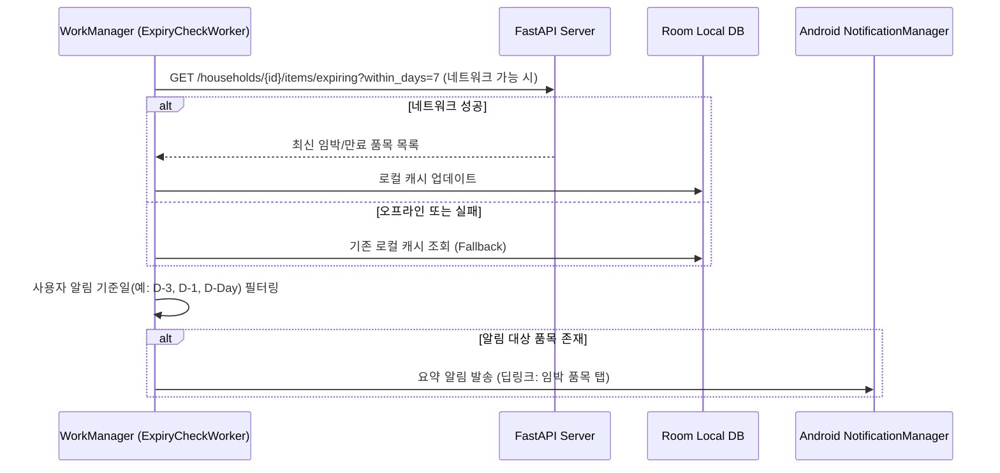

# 03. 유통기한·소비기한 정책 및 로컬 알림 명세

> **상태**: 초안 (Draft)  
> **최종 수정일**: 2026-11-19  
> **관련 문서**: [전체 시스템 아키텍처](../02-architecture/01-system-architecture.md), [Android 개발 가이드](../04-guides/02-android-setup.md)

---

## 1. D-Day 계산 및 상태 분류 정책

모든 D-Day 계산은 **사용자 기기의 로컬 날짜(KST 기준 `Asia/Seoul`)**를 기준으로 `expiry_date - today` 일수 차이로 산출합니다.

| 상태 | 조건 | 배지 표기 예시 | 색상 가이드 |
|---|---|---|---|
| **만료 (EXPIRED)** | `d_day < 0` | `D+2 (만료)` | Red |
| **당일 만료 (TODAY)** | `d_day == 0` | `D-Day` | Deep Orange / Red |
| **임박 (EXPIRING_SOON)** | `1 <= d_day <= alert_days` (기본 3일) | `D-1`, `D-3` | Amber / Orange |
| **여유 (SAFE)** | `d_day > alert_days` | `D-14` | Green / Neutral |
| **기한 없음 (NONE)** | `expiry_date == null` | `기한 없음` | Gray |

- `status != ACTIVE` (이미 소비 완료되었거나 폐기된 품목)는 알림 및 만료 카운트 대상에서 제외됩니다.

---

## 2. Android WorkManager 기반 로컬 알림 설계

Firebase(FCM) 등 외부 푸시 서버 의존성을 배제하고, **Android `WorkManager`만으로 안정적이고 무료인 기기 로컬 알림**을 구현합니다.

### 2.1 동작 흐름

### 2.2 스케줄링 및 배터리 최적화 대응
- **실행 주기**: `PeriodicWorkRequest`를 사용하여 하루 1회 사용자가 설정한 알림 시간(기본값: **오전 09:00**)에 근접하도록 초기 지연(`initialDelay`)을 계산해 예약합니다.
- **중복 알림 방지**: `DataStore`에 마지막 알림 발송 날짜(`last_notified_date`)를 저장하여, 동일 날짜에 WorkManager가 재실행되더라도 같은 요약 알림이 중복 발송되지 않도록 제어합니다.
- **Android 13+ 권한 처리**: 앱 온보딩 또는 알림 설정 화면에서 `POST_NOTIFICATIONS` 런타임 권한을 요청하고, 거부 시에도 앱 내 '임박 품목' 대시보드에서 확인할 수 있도록 안내합니다.

### 2.3 알림 채널 및 메시지 포맷
- **채널 ID**: `expiry_alert_channel` (중요도: `IMPORTANCE_DEFAULT`)
- **알림 내용 예시**:
  - 단일 품목: *"⏰ 유통기한 임박: `서울우유 1L` (D-1 · 주방 냉장고 > 냉장실)"*
  - 다수 품목: *"⏰ 만료 1건, 임박 3건이 있어요 — 서울우유 1L 외 3개 품목을 확인하세요."*
- **탭 동작**: 알림 클릭 시 앱의 **임박/만료 품목 필터 화면**으로 바로 이동(Deep Link).

### 2.4 사용자 커스텀 설정 (기기 로컬 저장)
- 알림 켜기/끄기 스위치
- 알림 기준 일수 선택 (기본 `D-3`, 선택지: 1일 / 3일 / 5일 / 7일 전)
- 알림 희망 시간 설정 (기본 오전 09:00)
- 만료된 품목 재알림 포함 여부 (기본 ON)
