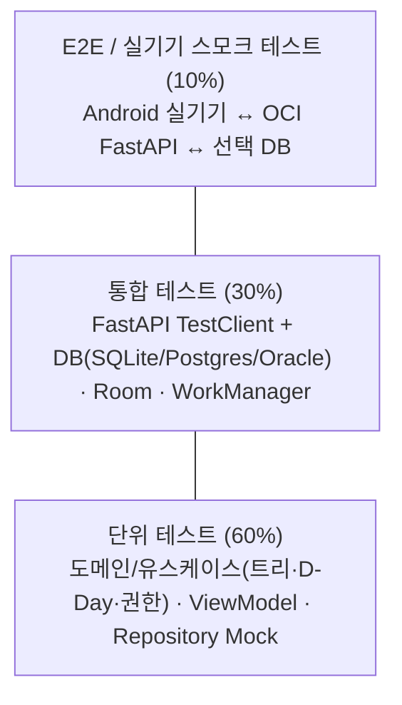
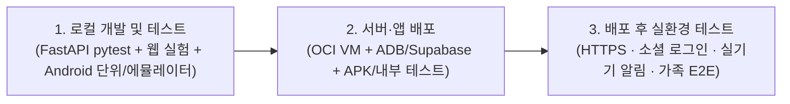

# 03. 테스팅 전략 및 품질 검증 가이드 (Testing Strategy)

> **상태**: 초안 (Draft)  
> **최종 수정일**: 2026-11-20  
> **관련 문서**: [개발 로드맵](../01-planning/02-roadmap.md), [백엔드 개발 가이드](./01-backend-setup.md), [Android 개발 가이드](./02-android-setup.md)

---

## 1. 테스트 피라미드 및 기본 원칙

무과금(OCI Always Free) 환경과 소규모 개발 리소스를 고려해, **빠르고 비용이 들지 않는 단위·통합 테스트에 80% 이상을 집중**하고, 핵심 흐름만 E2E로 검증합니다.



### 핵심 원칙
1. **외부 서비스 격리**: Google/Kakao OAuth 서버, 실제 운영 DB(OCI ADB / Supabase)에 의존하지 않고도 로컬에서 전체 테스트 스위트가 100% 통과해야 합니다.
2. **다중 DB 호환성 보장**: 백엔드 테스트는 SQLite(초고속)뿐 아니라 PostgreSQL(Supabase 호환) / Oracle 방언 차이를 검증할 수 있도록 설계합니다.
3. **보안·권한·알림 우선 검증**: 가족 가구 간 데이터 격리, 트리 순환 참조 방지, 오프라인 시 Room 폴백 및 중복 알림 방지를 최우선 테스트 대상으로 삼습니다.

---

## 2. 백엔드 테스팅 (FastAPI + pytest)

### 2.1 테스트 계층 및 도구
| 계층 | 도구 | 대상 | 실행 속도 |
|---|---|---|---|
| **단위 테스트 (Unit)** | `pytest` | D-Day 계산, 초대 코드 생성, 트리 순환 참조 감지, 빈 문자열 정규화 | 매우 빠름 (ms) |
| **API / 통합 테스트 (Integration)** | `pytest` + `httpx.AsyncClient` + SQLAlchemy | 라우터 → 유스케이스 → Repository → DB 트랜잭션, 401/403 권한 체크 | 빠름 (초 단위) |
| **DB 호환성 테스트 (Compatibility)** | `pytest` + Docker PostgreSQL / Oracle Free (선택) | `alembic upgrade head`, `WITH RECURSIVE` CTE, `Numeric`/`DateTime` 매핑 | 선택적/CI |

### 2.2 필수 테스트 시나리오
1. **인증 및 소셜 로그인 (`auth`)**
   - Google/Kakao 토큰 검증 API 호출은 `httpx.MockTransport` 또는 Fake OAuth Client로 대체하여 성공/만료/위조 토큰 케이스 검증
   - Refresh Token Rotation 동작 확인 (재사용 시 폐기된 토큰 거부 검증)
2. **가구 권한 및 데이터 격리 (`households`)**
   - 타 가구의 `location_id`, `item_id` 조회/수정/삭제 시 `403 Forbidden` 반환 확인
   - `MEMBER`가 초대 코드 발급(`POST /invites`)이나 가구명 수정 시 `403 Forbidden` 반환 확인
   - 만료된 초대 코드, 사용 횟수 초과 초대 코드 거부 확인
3. **자유 트리 보관 장소 (`locations`)**
   - 자기 자신 또는 자신의 하위 노드를 `parent_id`로 지정 시 `LOCATION_CYCLE_DETECTED` 에러 검증
   - `DELETE` 전략(`restrict` / `move` / `cascade`)별 하위 장소·품목 처리 및 트랜잭션 롤백 검증
4. **품목 재고 및 변경 이력 (`items` & `activities`)**
   - 등록·수량 수정·부분 소비·전량 소비(`CONSUMED`)·폐기(`DISCARDED`) 시 `activity_logs`가 **동일 트랜잭션 내**에 함께 기록되는지 검증
   - Oracle 빈 문자열(`""`) ↔ PostgreSQL 호환을 위한 공백 필드 `NULL` 정규화 검증

### 2.3 권장 디렉토리 구조
```text
backend/tests/
├── conftest.py                 # 테스트 DB 세션(롤백 픽스처), Fake OAuth, 인증 헤더 헬퍼
├── unit/
│   ├── test_location_tree.py   # 순환 참조 방지, 경로 조립 로직
│   └── test_invite_policy.py   # 초대 코드 생성/만료 검증
└── integration/
    ├── test_auth_api.py        # 소셜 로그인 모킹, JWT 발급/갱신
    ├── test_households_api.py  # 가구 생성, 초대 참여, 권한 격리
    ├── test_locations_api.py   # 트리 CRUD, 이동, 삭제 전략
    └── test_items_api.py       # 재고 CRUD, 소비/폐기, activity_logs 원자성
```

---

## 3. Android 앱 테스팅 (Kotlin + Jetpack Compose)

### 3.1 JVM 단위 테스트 (`src/test` — 에뮬레이터 불필요)
- **도구**: `JUnit5` (또는 `JUnit4`), `kotlinx-coroutines-test`, `Turbine`(Flow 검증), `MockK` (또는 Fake Repository)
- **테스트 대상**:
  - **Domain / UseCase**: D-Day 계산(`EXPIRED`, `TODAY`, `EXPIRING_SOON`, `SAFE`, `NONE`), 보관 장소 평면 리스트 → 트리 노드 변환
  - **ViewModel**: 로딩 → 성공 / 에러 UI State 전이, 검색어 및 필터 변경 시 목록 필터링 검증
  - **Network / Auth**: OkHttp `MockWebServer`를 사용해 Access Token 만료(401) 시 `TokenAuthenticator`가 Refresh 후 원요청을 자동 재시도하는지 검증

### 3.2 계측 / 로컬 DB / 백그라운드 테스트 (`src/androidTest`)
- **Room DAO 테스트**: `Room.inMemoryDatabaseBuilder()`로 실제 SQLite 쿼리(임박 품목 필터, 보관 장소별 조회, 트랜잭션 upsert) 검증
- **WorkManager 테스트**: `WorkManagerTestInitHelper` + `TestListenableWorkerBuilder<ExpiryCheckWorker>` 사용
  - 네트워크 성공 시: API 응답으로 Room 갱신 후 알림 발송 확인
  - 오프라인(네트워크 실패) 시: 기존 Room 캐시 기준으로 폴백 알림 발송 확인
  - 중복 방지: 동일 날짜(`last_notified_date == today`) 재실행 시 알림 미발송 확인
- **Compose UI 테스트**: `createComposeRule()`로 핵심 사용자 흐름 검증
  - 보관 장소 트리 펼치기/접기 및 하위 구역 이동
  - 품목 빠른 수량 조절(`-` / `+`) 및 수량 `0` 도달 시 소비 완료 확인 다이얼로그 표시

---

## 4. 개발 → 배포 → 운영 단계별 테스트 프로세스

전체 개발 및 배포 주기는 **로컬 검증 → 배포 → 배포 후 실환경 검증** 순서로 진행합니다.



### 4.1 1단계: 로컬 개발 및 테스트 (배포 전 필수 통과)
1. **백엔드 로컬 검증**:
   - 로컬 SQLite 또는 Docker PostgreSQL 환경에서 `pytest`(단위 + 통합 테스트) 100% 통과
   - `alembic upgrade head` 및 `downgrade` 마이그레이션 왕복 테스트
   - Swagger UI(`/docs`) 및 `ruff` 린트 통과
2. **웹 프론트엔드 기능 실험 (로컬)**:
   - 로컬 FastAPI(`http://localhost:8000`) ↔ 로컬 웹 프론트 연동
   - 가구 생성/초대, 보관 장소 자유 트리 생성·이동·삭제, 품목 등록·소비·폐기 및 변경 이력 왕복 확인
3. **Android 로컬 검증 (Phase 4)**:
   - JVM 단위 테스트(`./gradlew testDebugUnitTest`) 및 Room/WorkManager 계측 테스트 통과
   - 에뮬레이터 ↔ 로컬 FastAPI 연동(또는 개발 서버)으로 주요 화면 흐름 확인

### 4.2 CI 자동화 (GitHub Actions 무료 티어)
Public 저장소 무료(Private 저장소도 월 2,000분 무료) 범위 내에서 PR/Push마다 자동 실행합니다.
- **Backend Job**: Python 3.12 환경에서 `ruff`(린트) + `pytest` 실행
- **Android Job**: Gradle 캐시 적용 후 `./gradlew testDebugUnitTest lintDebug` 실행

### 4.3 2단계: 서버 및 앱 배포
- **백엔드 배포**: OCI Compute VM(Always Free)에 FastAPI + Caddy(HTTPS) 배포 및 선택 DB(Oracle ADB 또는 Supabase) `alembic upgrade head` 적용
- **앱 배포**: Release/Staging 빌드 생성(OCI HTTPS 도메인 `API_BASE_URL` 주입, 서명 키 적용) 후 가족 테스트용 APK 배포 또는 Google Play 내부 테스트 트랙 업로드

### 4.4 3단계: 배포 후 실환경 테스트 (Post-Deployment Smoke Test)
배포 직후 실제 클라우드 및 모바일 기기 환경에서 아래 항목을 반드시 최종 검증합니다. 실기기 UI/E2E 검증은 **무선 디버깅 + Google ARTEMIS**([04-artemis-wireless-testing.md](./04-artemis-wireless-testing.md))를 통해 자동화하여 반복 실행합니다.
1. **인프라/DB 헬스체크**: `GET https://<domain>/api/v1/health` → 선택 DB(Oracle ADB 또는 Supabase) 연결 `200 OK` 및 SSL 인증서 유효성 확인
2. **소셜 로그인 & JWT 갱신**: Android 실기기에서 Google/Kakao 실제 로그인 → Access Token 만료 후 Refresh Token 자동 갱신 동작 확인
3. **가족 공동 관리 E2E (ARTEMIS 시나리오)**: 2대 이상의 실기기(가족 계정 A·B)에서 초대 코드 참여 후, 기기 A에서 품목 등록/소비 시 기기 B 새로고침 및 변경 이력에 즉시 반영되는지 확인
4. **WorkManager 로컬 알림 실기기 검증**: 실기기 배터리 최적화/알림 권한(`POST_NOTIFICATIONS`) 허용 상태에서 임박 품목 알림 수신 및 알림 탭 시 딥링크 이동 확인
5. **무료 티어 안전 점검**: OCI Budget Alert 정상 설정 여부 및 DB 자동 중지 방지 `cron` 동작 확인
